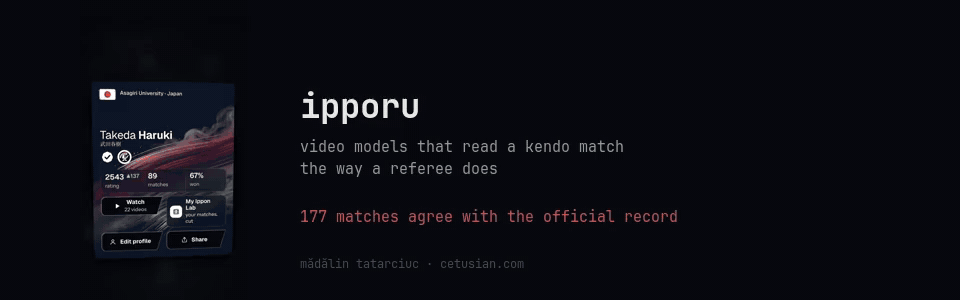

### mădălin tatarciuc

applied ai researcher at invergent, in romania, remote. i train small models that do one job, and build the products that put them to work.

- **[ipporu](https://ipporu.com)**: the home of kendo. video models that read a match the way a referee does; on 177 matches the engine's ippons agree with the official record. [how the models work](https://cetusian.com/work/ipporu)
- **[surogate](https://github.com/invergent-ai/surogates)** at invergent: i led [jackrabbit-110m-ro](https://huggingface.co/surogate/jackrabbit-110m-ro), romanian speech recognition at 5.69% wer on fleurs (whisper large-v3: 8.42%), and [amami-357m-ro](https://huggingface.co/surogate/amami-357m-ro), three romanian voices on a cpu. then the phone line, discord, teams, and the rehearsal where autopilot plays the customer. the models are invergent's, cc-by-nc-4.0. [what i built there](https://cetusian.com/work/surogates)
- **[superstarling](https://cetusian.com/work/superstarling)**: ten agents in one workspace that draft a small shop's week and wait for a yes. not launched yet.
- **[LlamaRanch](https://github.com/madalintat/LlamaRanch)**: a ranch for your local models.
- **[rust-handbook](https://github.com/madalintat/rust-handbook)**: learn rust by fighting the compiler.

[cetusian.com](https://cetusian.com) · [cv](https://cetusian.com/cv) · [hugging face](https://huggingface.co/cetusian) · [linkedin](https://www.linkedin.com/in/madalin-tatarciuc)
